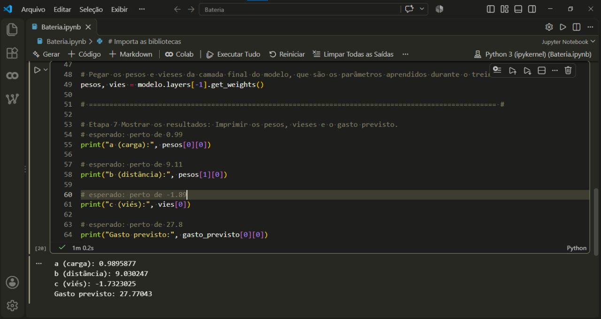

# Previsão de Bateria com Machine Learning (TensorFlow e Keras)

## 📌 O que o projeto faz

Este projeto implementa um modelo de aprendizado de máquina (Regressão Linear com Keras) estruturado para prever o consumo percentual de uma bateria. O sistema aprende a partir de dados medidos anteriormente (relacionando peso/carga e distância) para estimar o gasto energético de forma automatizada. 

Para fins de organização técnica e clareza, o desenvolvimento do script foi estruturado didaticamente em **7 etapas práticas** (desde a preparação e conversão dos dados até a extração e validação dos resultados).

---

## 💻 Ambiente de Desenvolvimento

- **Fase Inicial:** Desenvolvido e testado no ambiente em nuvem do **Google Colab**, aproveitando os recursos de execução em Python.

- **Fase Final / Organização:** Finalizado localmente no **VS Code**, utilizando a extensão do Colab para integração contínua e execução do notebook.

---

## 📂 Estrutura do Projeto

- `Bateria/Bateria.ipynb`: Código-fonte principal contendo a importação dos dados, a estruturação da rede neural, o treinamento e a inferência.

- `imagens/imagem.jpg`: Registro visual do log de resultados gerado após o treino.

---

## 🚀 Como Usar

1. Clone o repositório em sua máquina.

2. Abra o arquivo `Bateria/Bateria.ipynb` utilizando o Google Colab ou o VS Code (com a extensão Jupyter instalada).

3. Certifique-se de ter as bibliotecas necessárias instaladas no seu ambiente (`tensorflow`, `numpy`).

4. Execute o script sequencialmente para carregar os dados de treino, compilar o modelo otimizado e realizar as previsões de teste.

---

## 💻 Código-Fonte

Abaixo está o script estruturado para o treinamento do modelo. O fluxo está claramente dividido nas **7 etapas práticas** mencionadas, com os hiperparâmetros ajustados para otimização de tempo e precisão:

```python

# Importa o módulo drive do Google Colab para montar o Google Drive e acessar os arquivos armazenados nele.
from google.colab import drive
# Monta o Google Drive para acessar os arquivos no caminho ("/content/drive").
drive.mount("/content/drive")

# Importa as bibliotecas
import numpy as np
import tensorflow as tf
import pandas as pd

# Avisa ao python em qual pasta procuar o arquivo que será importado.
import sys

# Adicona a pasta do drive na lista de caminhos do Python para que ele encontre o arquivo que será importado.
sys.path.append("/content/drive/MyDrive/Primus/Prints")

# Importa o módulo Prints, que contém funções para exibir os resultados de forma organizada.
import Prints

# Define o caminho do arquivo CSV contendo os dados do dataset.
caminho = "/content/drive/MyDrive/Primus/Dataset/Bateria.csv"

# Lê o arquivo CSV contendo os dados do dataset e armazena em um DataFrame do pandas.
bateria = pd.read_csv(caminho)

# Solicita ao usuário que insira os valores de carga e distância para prever o gasto de bateria.
carga = float(input("Digite a carga (kg): "))

distancia = float(input("Digite a distância (km): "))

# Define os limites de carga mínima e máxima para validação dos dados inseridos pelo usuário.
cargaMin, cargaMax = 1.0, 100

# Define os limites de distância mínima e máxima para validação dos dados inseridos pelo usuário.
distanciaMin, distanciaMax = 1.0, 9.0

# Verifica se a carga digitada não está entre o mínimo e o máximo, se é inválida.
if not (cargaMin <= carga <= cargaMax):
    print(f"Erro: Carga ({carga} kg) fora do limite físico permitido ({cargaMin} a {cargaMax} kg). Dado não salvo.")
# Verifica se a distância digitada não está entre o mínimo e o máximo, se é inválida.
elif not (distanciaMin <= distancia <= distanciaMax):
    print(f"Erro: Distância ({distancia} km) fora do limite permitido ({distanciaMin} a {distanciaMax} km). Dado não salvo.")
# Se os dados de entrada forem válidos, o fluxo de treinamento começa aqui.
else:
    # ==================================================================================================== #

    # Etapa 1 e 2; Dados e Preparo: Junta os exemplos com a resposta certa e converte as listas para arrays np com float32, que é o tipo que o TensorFlow entende.
    medicoes_viagens = np.array(bateria[["Carga", "Distância"]], dtype=np.float32)
    gasto_viagens = np.array(bateria[["Gasto"]], dtype=np.float32)

    # ==================================================================================================== #

    # Etapa 3 Criar o modelo: Duas entradas "(Input/shape=(2,))," e uma camada "Dense" com 1 neurônio.
    modelo = tf.keras.Sequential([
        tf.keras.layers.Input(shape=(2,)),
        tf.keras.layers.Dense(1)
    ])

    # ==================================================================================================== #

    # Etapa 4 Compilar o modelo: Escolher o otimizador e a função de perda.
    modelo.compile(optimizer=tf.keras.optimizers.Adam(0.05), loss="mse")

    # ==================================================================================================== #

    # Etapa 5 Treinar o modelo: Ajustar a regra pra errar menos, repetindo por 1300 epochs (passadas) sobre os dados, verbose=0 pra não mostrar o progresso na tela.
    modelo.fit(medicoes_viagens, gasto_viagens, epochs=500, verbose=0)

    # Após o fit rodar, o Keras guarda o histórico"(history) objeto" dentro do próprio modelo:
    perdas = modelo.history.history["loss"][-1]

    # ==================================================================================================== #

    # Etapa 6 Usar o modelo: Prever o gasto de bateria pra uma nova viagem, com os dados validados.
    nova_viagem = np.array([[carga, distancia]], dtype=np.float32)

    # Prever o gasto de bateria usando o modelo treinado, numpy() converte o tensor de saída em array NumPy, permitindo usar [0][0] sem alterar o restante
    gasto_previsto = modelo(nova_viagem, training=False).numpy()

    # Pegar os pesos e vieses(bias) da camada final do modelo, que são os parâmetros aprendidos durante o treinamento.
    pesos, vies = modelo.layers[-1].get_weights()

    # ==================================================================================================== #

    # Etapa 7 Salvar os dados no CSV: Se o gasto previsto for válido, salva os dados no arquivo CSV.

    # Calcula o gasto previsto para os valores inseridos pelo usuário
    gasto_calculado = float(gasto_previsto[0][0])

    # Como o gasto é em porcentagem (%), ele nunca pode ser negativo nem estourar 100%
    gasto_min, gasto_max = 0.0, 100.0

    # Verifica se o gasto previsto não está entre o mínimo e o maximo, se é inválido. Se for inválido, mostra um alerta e não salva o dado no CSV.
    if not (gasto_min <= gasto_calculado <= gasto_max):
        print(f"Alerta: A previsão de gasto ({gasto_calculado:.2f}%) é fisicamente impossível. Possível ponto fora da curva. Dado descartado.")
    else:
        # Se passou em tudo, salva no CSV de forma limpa com mode='a' no pd.DataFrame, sem sobrescrever o cabeçalho e sem salvar o índice.
        pd.DataFrame(
            [[carga, distancia, gasto_calculado]],
            columns=["Carga", "Distância", "Gasto"]
        ).to_csv(caminho, mode='a', header=False, index=False)

    # Mostra os resultados na tela, incluindo os pesos e vieses aprendidos pelo modelo, bem como o gasto previsto para a viagem.
    Prints.mostrar_resultados(carga, distancia, perdas, pesos, vies, gasto_previsto)

```

---

## 🖼️ Imagens do Projeto

Resultados gráficos e visualizações do treinamento do modelo:

### Para importar e usar o drive no Colab


### Saída do resultado do Treino


---

## 🧠 O que aprendi durante o desenvolvimento do projeto

1. **Otimização do Método de Inferência:**

   Entendimento sobre a diferença de desempenho entre utilizar o método `model.predict()` e a chamada direta do objeto do modelo (`model(data, training=False).numpy()`). A chamada direta evita o *overhead* e os avisos de *retracing* do TensorFlow (`tf.function`) em execuções de inferência individual, resultando em um código mais limpo e execução mais eficiente.

2. **Calibração Empírica de Hiperparâmetros (Ajuste de Épocas):**

   Compreensão sobre o impacto da quantidade de épocas no tempo de execução e na convergência do modelo. O material de estudo sugeria 3.000 épocas, porém, após testes empíricos controlados (avaliando o comportamento a cada variação de épocas), identificou-se o valor de **1.450 épocas** como a quantidade ideal para alcançar os parâmetros matemáticos desejados ($a \approx 0.99$, $b \approx 9.11$, $c \approx -1.89$) mantendo o tempo de execução reduzido para cerca de 1 minuto.

---

## 🛠️ Stack Tecnológica e Referências

Para manter o código-fonte limpo, direto e sem poluição de comentários excessivos, as bibliotecas, classes, métodos e hiperparâmetros utilizados no script são documentados abaixo com suas respectivas referências oficiais:

### 1. Manipulação de Dados (`NumPy`)

- **`np.array`**: Cria tabelas estruturadas de dados (arrays multidimensionais) para processamento no TensorFlow. ([Documentação numpy.array](https://numpy.org/doc/stable/reference/generated/numpy.array.html))

- **`dtype=np.float32`**: Define o tipo de dado como decimal de 32 bits, padrão utilizado em modelos de precisão simples no TensorFlow. ([Documentação Tipos NumPy](https://numpy.org/doc/stable/user/basics.types.html))

### 2. Construção da Rede Neural (`TensorFlow / Keras`)

- **`tf.keras.Sequential`**: Agrupa uma pilha linear de camadas neurais para o fluxo sequencial de dados. ([Documentação tf.keras.Sequential](https://www.tensorflow.org/api_docs/python/tf/keras/Sequential))

- **`tf.keras.layers.Input`**: Define o formato de entrada (*shape*) dos dados na rede (2 variáveis: carga e distância). ([Documentação tf.keras.layers.Input](https://www.tensorflow.org/api_docs/python/tf/keras/Input))

- **`tf.keras.layers.Dense`**: Camada densamente conectada que realiza a operação linear $a \times \text{carga} + b \times \text{distância} + c$. ([Documentação tf.keras.layers.Dense](https://www.tensorflow.org/api_docs/python/tf/keras/layers/Dense))

### 3. Otimização e Treinamento

- **`compile()`**: Configura o modelo definindo o otimizador e a função de custo. ([Documentação Model.compile](https://www.tensorflow.org/api_docs/python/tf/keras/Model#compile))

- **`optimizer=tf.keras.optimizers.Adam`**: Otimizador adaptativo que ajusta os pesos e o viés a cada passo do algoritmo. ([Documentação tf.keras.optimizers.Adam](https://www.tensorflow.org/api_docs/python/tf/keras/optimizers/Adam))

- **`loss="mse"` (Mean Squared Error)**: Função de perda que calcula a média dos quadrados dos erros para orientar o ajuste dos pesos. ([Documentação MeanSquaredError](https://www.tensorflow.org/api_docs/python/tf/keras/losses/MeanSquaredError))

- **`fit()`**: Executa o ciclo de treinamento com os dados de entrada e saída. ([Documentação Model.fit](https://www.tensorflow.org/api_docs/python/tf/keras/Model#fit))

- **`epochs`**: Hiperparâmetro que define a quantidade de ciclos completos de treinamento sobre o conjunto de dados (otimizado para **1.450 épocas**).

- **`verbose=0`**: Oculta a exibição do log de progresso de cada época no terminal/notebook durante o treinamento.

### 4. Extração de Parâmetros e Inferência

- **`get_weights()`**: Recupera os pesos sinápticos e o viés ($a, b \text{ e } c$) aprendidos pela camada densa ao término do treinamento. ([Documentação Layer.get_weights](https://www.tensorflow.org/api_docs/python/tf/keras/layers/Layer#get_weights))

- **Chamada Direta do Modelo (`model(data, training=False).numpy()`)**: Executa a inferência diretamente pelo objeto do modelo em vez de usar `.predict()`, otimizando a velocidade e reduzindo overhead.

---

🚀 Próximos projetos  

Outros projetos serão postados em breve, com arquiteturas diferentes e níveis de complexidade maiores.

👤 Autor: Bruno Zucker
